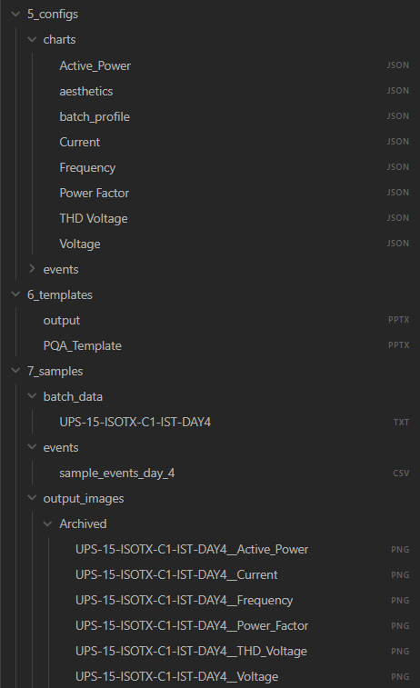

# Trend Graph Software (Elec) — User Manual

> **Version:** 1.0.2
> **Last Updated:** 2026-04-03

---

## Table of Contents

- [Quick Run (recommended)](#quick-run-recommended)
1. [Overview](#1-overview)
2. [Getting Started](#2-getting-started)
   - 2.1 [What You Need](#21-what-you-need)
   - 2.2 [Downloading from SharePoint](#22-downloading-from-sharepoint)
   - 2.3 [Setting Up Your Folders](#23-setting-up-your-folders)
   - 2.4 [Launching the App](#24-launching-the-app)
3. [Config Folder Setup](#3-config-folder-setup)
   - 3.1 [What Is the Config Folder?](#31-what-is-the-config-folder)
   - 3.2 [Folder Structure](#32-folder-structure)
   - 3.3 [Pointing the App to Your Config Folder](#33-pointing-the-app-to-your-config-folder)
4. [Generating Charts](#4-generating-charts)
   - 4.1 [Loading Your Data File](#41-loading-your-data-file)
   - 4.2 [Selecting Chart Configs](#42-selecting-chart-configs)
   - 4.3 [Previewing and Exporting Charts](#43-previewing-and-exporting-charts)
5. [Batch Processing](#5-batch-processing)
   - 5.1 [What Is Batch Processing?](#51-what-is-batch-processing)
   - 5.2 [Setting Up a Batch Profile](#52-setting-up-a-batch-profile)
   - 5.3 [Running a Batch Job](#53-running-a-batch-job)
6. [Gantt / Events Chart](#6-gantt--events-chart)
   - 6.1 [What Is the Gantt Chart?](#61-what-is-the-gantt-chart)
   - 6.2 [Loading an Events File](#62-loading-an-events-file)
   - 6.3 [Viewing the Gantt Chart](#63-viewing-the-gantt-chart)
7. [PowerPoint Export](#7-powerpoint-export)
   - 7.1 [How the Export Works](#71-how-the-export-works)
   - 7.2 [Exporting to PowerPoint](#72-exporting-to-powerpoint)
8. [Config Manager](#8-config-manager)
   - 8.1 [What Is the Config Manager?](#81-what-is-the-config-manager)
   - 8.2 [Viewing and Editing a Config](#82-viewing-and-editing-a-config)
9. [Troubleshooting & FAQ](#9-troubleshooting--faq)

---

## Quick Run (recommended)

The **🚀 Quick Run** tab opens first and covers a normal job on one page. No config folder is needed, because the default charts, colours and PowerPoint template are built into the app.

1. **Test schedule:** pick your event schedule (CSV or Excel `.xlsx`). It needs the columns *Test Description, Test ID, Date, Start Time, End Time* (and optionally *Normalized Time*). A title block above the header row is fine. The plot window (*Plot from / to*) is worked out from the first and last event, with 30 minutes either side. You can edit it if needed.
2. **Analyser data:** pick the folder that holds your analyser exports. Each file is listed with its brand (**Fluke** or **Hioki**); files in mixed brands can sit in the same folder. Choose the **system wiring**:
   - **3-phase 4-wire (with N):** Voltage and THD charts show phase-to-neutral (AN/BN/CN) where the export has it.
   - **3-phase 3-wire (without N):** Voltage and THD charts show line-to-line (AB/BC/CA).

   Hioki exports name their own channels (U1 = phase-to-neutral, U12 = line-to-line), so they are always labelled correctly. If an export only has total power / PF (no per-phase values), those two charts are skipped for that file and listed after the run.
3. **Charts & output:** pick an output folder, tick the charts you want, and set **Y min / Y max** per chart. Switch on **Auto Y** to fit the axis to the data.
4. Click **▶ Generate charts**. When it finishes you can **Open folder**, **Build PowerPoint** or **Download ZIP**.

If a data file has no readings inside the plot window, a ⚠ warning names it after the run. This usually means the wrong schedule or the wrong day's data.

Everything you choose (folders, event file, charts, Y limits) is remembered for next time. Click **↺ Reset Y limits** to go back to the defaults. The other tabs are still available for advanced use, such as a custom config folder in Config Manager.

---

## 1. Overview

**Trend Graph Software (Elec)** is an internal data visualisation tool for electrical engineers and analysts. It lets you:

- Plot composite trend charts (voltage, current, power factor, frequency, THD, etc.) from raw data files
- Overlay Gantt-style event timelines on your charts
- Export charts directly into a formatted PowerPoint presentation
- Run batch jobs to process multiple data files at once

The app runs entirely on your local machine — no internet connection is required after setup.

---

## 2. Getting Started

### 2.1 What You Need

Before you begin, make sure you have:

- A Windows PC (Windows 10 or later)

*No installation is required — the app runs as a standalone `.exe` file.*

---

### 2.2 Downloading from SharePoint

1. Open the team SharePoint site and navigate to the **Trend Graph Software** folder.(https://bbengsb1.sharepoint.com/:f:/s/BlueBlubEngineeringSdnBhd383/IgDdsYKIl4pwSqMeZd-KbTP2AZMS1zWq3eU2O9fmrGyV45w?e=0hTvac)
2. Download both files:
   - `TrendGraph_v1.0.1.exe` — the application
   - `configs.zip` — the configuration and template bundle

> **Tip:** If you are unsure where the SharePoint folder is, ask your team lead for the link.

---

### 2.3 Setting Up Your Folders

1. Create a folder on your PC where you want to keep the app — for example:
   ```
   C:\Users\YourName\TrendGraph\
   ```
2. Move `TrendGraph_v1.0.1.exe` into that folder.
3. Extract `configs.zip` into the **same folder**. After extraction you should see:
   ```
   TrendGraph\
   ├── TrendGraph_v1.0.1.exe
   ├── 5_configs\
   │   ├── charts\
   │   └── events\
   ├── 6_templates\
   │   └── output.pptx
   │   └── PQA_Template.pptx
   └── 7_samples
   │   └── batch data\
   │   └── events\
   ```

> **Important:** Ensure you have these 3 folders which is `configs`,`templates`,`samples (or actual data)`. It must follow this format but can stored in anywhere


---

### 2.4 Launching the App

1. Double-click `TrendGraph_v1.0.1.exe`.
2. A black console window may appear briefly — this is normal.


3. A **folder picker dialog** will appear asking you to select your config folder.


4. Navigate to your `TrendGraph` folder and select **`5_configs`**.
5. Click **Select Folder**.
6. The app will open in your default web browser automatically (usually at `http://127.0.0.1:8050`).

> **Note:** The app runs locally in your browser. You do not need an internet connection and no data is sent anywhere.

---

## 3. Config Folder Setup

### 3.1 What Is the Config Folder?

The config folder (`5_configs`) contains JSON files that tell the app **how to draw each chart** — which signals to plot, what colours to use, axis labels, and more. Think of each JSON file as a "recipe" for a specific chart type.

You should not need to edit these files for day-to-day use. If a chart needs to be changed or a new one added, you do so with the `Config Manager` feature in the software. As a standard practice, it is recommended to have 1 folder of configs for each project.

---

### 3.2 Folder Structure

Inside `5_configs` you will find two sub-folders:

| Folder | Contents |
|---|---|
| `charts\` | JSON configs for trend/composite charts (voltage, current, etc.) |
| `events\` | JSON config for the Gantt / events chart |

Each JSON file in `charts\` corresponds to one chart type available in the app.

---

### 3.3 Pointing the App to Your Config Folder

The app asks you to select your config folder **every time it launches**. This means:

- You can keep configs in any location you like
- Different users can maintain their own config sets
- No settings are saved between sessions

If you select the wrong folder by mistake, you can just reselect it by clicking the browse button.

---

## 4. Generating Charts

### 4.1 Loading Your Data File

1. On the main screen, find the **Data File** section.
2. Click **Browse** (or drag and drop your file onto the upload area).
3. Select your `.txt` data file from your instrument (PQA, Hioki or Fluke).
4. The app will read the file and display a summary (date range, number of records, etc.).


> **Tip:** Sample data files are available in the `7_samples\batch_data\` folder inside the repo if you need to test the app.

---

### 4.2 Selecting Chart Configs

1. After loading your data file, you can browse and log the config file.
2. For example:
   - `2_config_composite_Voltage`
   - `5_config_composite_Frequency`
   - `Active_Power`


3. You can select only one charts at the time to plot and live view, only `Batch Processing` can plot multiple charts.

---

### 4.3 Previewing and Exporting Charts

1. Click **Generate Charts**, it will show an indicator after it is done.


2. A preview of the selected chart will appear on the Live Preview Tab.


3. To save a chart as an image (`.png`):
   - Hover over the chart and use the **camera icon** in the top-right corner of the chart.
   - The image will be saved to your browser's default downloads folder.


---

## 5. Batch Processing

### 5.1 What Is Batch Processing?

Batch processing lets you generate charts for **multiple data files at once**, without loading each file individually. This is useful when you have data from several test days or multiple measurement points.

---

### 5.2 Setting Up a Batch Profile

A batch profile is a saved list of files and chart configs to process together. Profiles are stored in `5_configs\charts\batch_profile.json` and can be managed through the app.

1. Navigate to the **Config Manager** tab in the top menu and locate `Batch Profile`.
2. Load the config folder's chart to reveal the batch profile.


3. Here you can edit the how the batch is process, you can suppress the batch by switcing off, rearrange by clicking the up-down button on each config file. 
4. Click **Save Profile** after any customization is done.

---

### 5.3 Running a Batch Job

1. Before you start batch processing, you must select these folder: `config_foler` (where you store your batch profile and other config files), `data folder` (The folder that contain all the data wanted to plot), `output folder` (An output folder where the images will go). 
2. Click **Run Batch**.
2. A progress indicator will show each file being processed. You can preview the arrangement/order that you previously customized for the batch, 


3. When complete, all output charts will be saved to the output folder shown on screen.

> **Note:** Batch jobs can take a few minutes depending on how many files and chart types are selected. Do not close the console window while a batch is running.

---

## 6. Gantt / Events Chart

### 6.1 What Is the Gantt Chart?

The Gantt chart displays a timeline of electrical events (e.g. voltage dips, outages, alarms) layered on top of a time axis. It is useful for correlating events with your trend data.

---

### 6.2 Loading an Events File

1. Navigate to the **Events / Gantt** tab.
2. Click **Browse** and select your events file (`.csv` format).

> **Tip:** A sample events file is available at `7_samples\events\sample_events_day_4.csv`.

3. The app will validate the file format. If there are any issues, an error message will describe what to fix.

---

### 6.3 Viewing the Gantt Chart

1. After loading the events file, click **Preview**.
2. The chart will appear below, showing each event as a coloured bar on a timeline.


---

## 7. PowerPoint Export

### 7.1 How the Export Works

The app uses a PowerPoint template (`6_templates\PQA_Template.pptx`) to produce a formatted report. Each chart you have generated is inserted into a predefined slide layout automatically.

---

### 7.2 Exporting to PowerPoint

1. Click the `PPT builder` Tab
2. Load the required folders as shown as the image below
3. Give the PPT a name and click **Build PPTX** 


> **Note:** The output uses the template from your `6_templates` folder. If the template has been updated by your team, make sure you have the latest `configs.zip` from SharePoint of the project itself.

4. An indicator will be shown when it is done just like the image below:


---

## 8. Config Manager

### 8.1 What Is the Config Manager?

The Config Manager is a built-in screen that lets you **view and edit chart config files and event config** without opening them manually in a text editor. It is intended for users who need to adjust chart settings (e.g. signal names, axis ranges, colours) without touching raw JSON.

> **Caution:** Changes made here affect how charts are drawn for everyone using the same config folder. If you are unsure, check with the tool maintainer before editing.

---

### 8.2 Viewing and Editing a Config

1. Navigate to the **Config Editor** tab by going to the **Config Manager** tab and scroll down.
2. Select a config file from the dropdown list.


3. The settings for that config will appear as editable fields.
4. Make your changes and click **Save**.


5. Click the **Refresh** button and your changes take effect the next time you generate a chart using that config.


> **Tip:** Load the config folder first before performing any operation in the **Config Manager Tab**.

---
